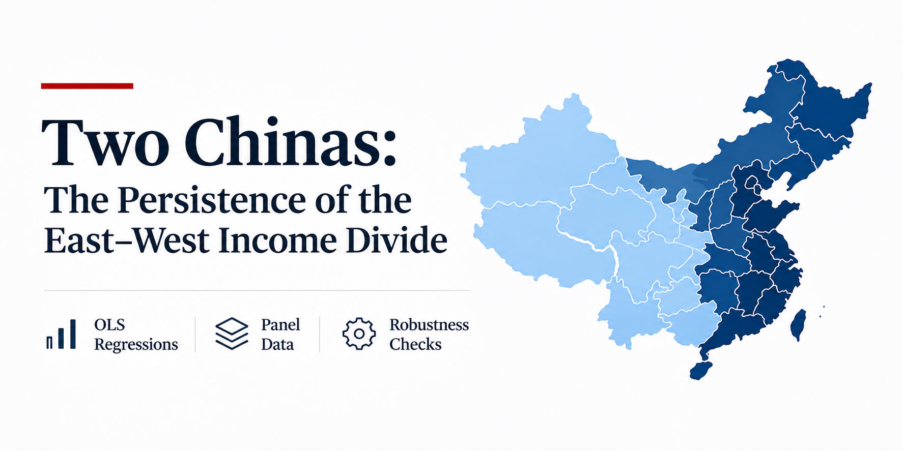

# Dylan Durrans Padilla

**M.S. Quantitative Economics @ UCLA | Finance · Econometrics · Investment Research**

I apply quantitative methods to economic research, financial analysis and investment decisions.

## Selected Research & Projects

### Two Chinas: The Persistence of the East–West Income Divide

**OLS Regressions · Panel Data · Robustness Checks**

Econometric research examining income inequality across 22 Chinese provinces (2005–2023).

[View full dissertation](https://github.com/dylandurrans/china-regional-inequality)

### Spotless: Los Angeles Parking Occupancy Analysis

Collaborative econometric research examining parking occupancy across 4,016 metered spaces in Los Angeles using Python, OLS regressions and cross-validation.

[View Spotless project](https://github.com/finnrcase/Spotless)

### Manchester United plc — Equity Valuation

**DCF Valuation · Comparable Companies · Investment Research**

Independent equity research evaluating Manchester United plc through three-scenario DCF modelling, financial statement analysis and comparable-company valuation. Investment recommendation: **HOLD**.

[View full investment analysis](https://github.com/dylandurrans/manchester-united-valuation)
